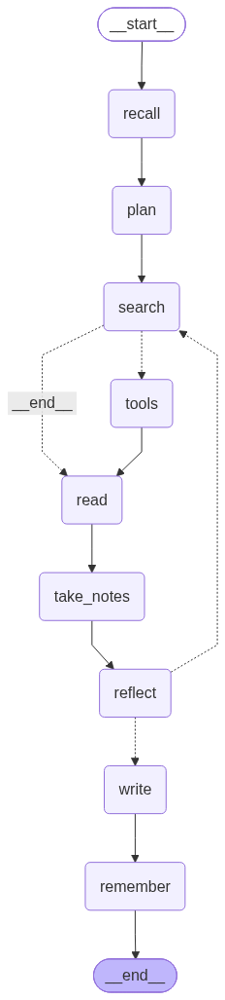

# langgraph-research-agent

A LangGraph agent that searches, reads, remembers past research and writes a cited brief.
It runs fully on your laptop: qwen2.5:7b through Ollama, a small local embedding model, and three
search APIs that need no key (arXiv, Wikipedia, Hacker News).



```
recall -> plan -> search -> tools -> read -> take_notes -> reflect --(gaps, under 2 rounds)--> search
                                                               \--(enough)--> write -> remember
```

- **recall**: past notes from SQLite memory that are close in meaning to the question
- **plan**: the LLM splits the question into 3 or 4 sub-questions
- **search**: the LLM picks tools and queries (real tool calling); `tools` runs them
- **read**: fetch each new source, clean it, keep the 3 passages closest to the question
- **take_notes**: claim + exact quote per note; a note whose quote isn't in the page is dropped
- **reflect**: which sub-questions are still open? loop back, at most `MAX_ROUNDS` times
- **write**: a structured brief where every sentence lists its sources; sentences whose sources
  don't support them are removed, and the sources are renumbered into a Markdown list
- **remember**: new notes go into long-term memory for the next question

## Quickstart

```bash
python -m venv .venv && source .venv/bin/activate
pip install -r requirements.txt
ollama pull qwen2.5:7b          # about 4.7 GB, once
cp .env.example .env
python run.py "How is machine learning used to detect faults in centrifugal pumps?"
```

The brief lands in `briefs/`, the per-sentence citation report in `runs/`.

Other scripts:

```bash
python try_tools.py              # call each search tool by hand
python try_tool_calling.py       # check the model really emits tool calls
python draw_graph.py             # ASCII, Mermaid and PNG of the graph
python show_memory.py "a new question"   # what's in memory, and what it would recall
python -m pytest -v              # unit tests (no LLM needed)
python evals/run_evals.py        # citation validity, coverage and step counts on 4 questions
```

## Use a cloud model instead

Change one line in `.env`:

```
LLM_MODEL=anthropic:claude-sonnet-5-5
```

and `pip install langchain-anthropic` with `ANTHROPIC_API_KEY` set. Any provider that LangChain's
`init_chat_model` supports works the same way.
